<!-- Palette: void #0d0610 | pink #ff8fc7 | hot pink #ff4fa3 | blush #ffd1e8 | sage #a8c5a0 -->

<h1 align="center">
  
</h1>

  

<h2 align="center">⛧ about me ⛧</h2>

  <i>♱ data &amp; business intelligence student 
  ♱ i build pipelines, models and dashboards that actually make sense 
  ♱ dark mode forever, pink accents always ♡</i>

<h2 align="center">✦ skills ✦</h2>

  
  
  
  
   
  
  
  
   
  
  
  

<h2 align="center">♡ stats ♡</h2>

  
  

  

